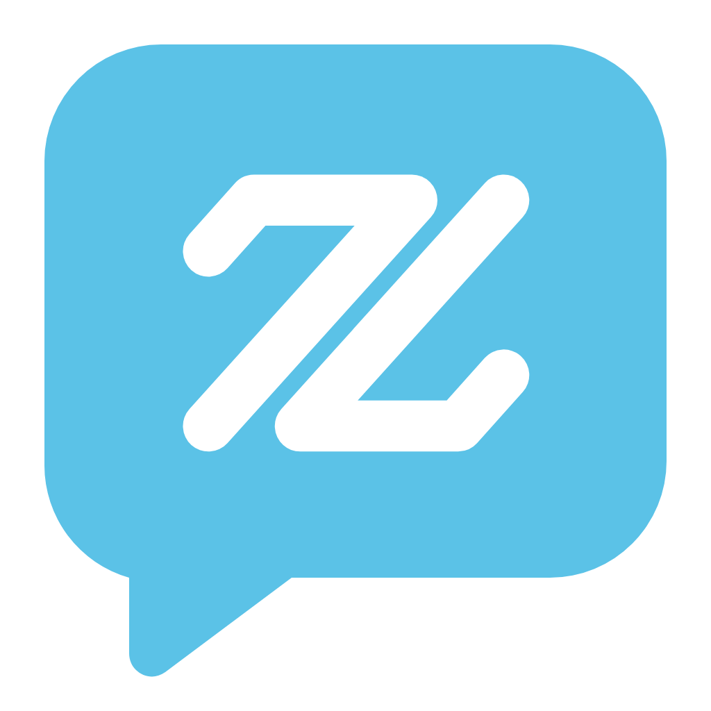

<p align="center"></p>

<h1 align="center">Zpeak</h1>

<p align="center">Speak anywhere. Press <kbd>Alt</kbd> + <kbd>Z</kbd>, talk, and your words appear where you're typing.</p>

<p align="center">
  <a href="https://github.com/Zense-AI/zpeak/releases/latest/download/Zpeak-Windows-x64-Setup.exe">Download for Windows</a> ·
  <a href="https://github.com/Zense-AI/zpeak/releases/latest/download/Zpeak-macOS-Universal.dmg">Download for Mac</a>
</p>

## Why

When we teach in classrooms, many students have big ideas but struggle to put them into words, and typing gets in the way even more. How well a student can use AI depends on how well they can talk to a computer. When typing is the bottleneck, they can't communicate at all.

The Zense AI platform has speech-to-text built in, but students learn across many digital tools. Zpeak brings the same thing everywhere: a small app in the taskbar that turns speech into text in any app, whether that's a browser, a document, a chat, or an AI tool.

## How it works

1. Zpeak lives in the Windows taskbar tray or the macOS menu bar.
2. Click into any text box and press <kbd>Alt</kbd> + <kbd>Z</kbd> (you can change the shortcut).
3. Speak, then press the shortcut again. Zpeak transcribes your speech and pastes the text into the box. Your clipboard is put back afterwards.

You can also choose **Hold to talk** in Settings.

## Choose how Zpeak listens

| Option | Cost | Where audio goes |
| --- | --- | --- |
| **Zense AI** | Free and unlimited for Zense AI school accounts and paid plans | Zense AI's servers, over HTTPS |
| **On this computer (Whisper)** | Free | Nowhere. It runs offline with [whisper.cpp](https://github.com/ggml-org/whisper.cpp) |
| **OpenRouter** | Pay-as-you-go with your own key | [OpenRouter](https://openrouter.ai) and the model you choose |

On-device models download once from Hugging Face and are checked against a pinned SHA-256 hash before use. Large v3 Turbo is the only one that supports Cantonese.

## Security

Zpeak is open source, so it ships **no secrets**.

- **Zense AI sign-in** uses OAuth 2.0 authorization code with PKCE (S256) and a loopback redirect on `127.0.0.1` ([RFC 8252](https://www.rfc-editor.org/rfc/rfc8252)). You approve Zpeak on `app.zenseai.io` in your browser, so Zpeak never sees your password.
- Tokens are opaque random strings. The server stores only their SHA-256 hashes, and they work only for Zpeak's transcription endpoint, not the rest of your account. Access tokens expire after 1 hour. Refresh tokens rotate on every use, and reusing an old one signs that device out.
- You can see and sign out Zpeak devices any time in Zense AI → Settings → Connectors.
- Tokens and your OpenRouter key are stored in the OS keychain (Windows Credential Manager / macOS Keychain), never in plain files.
- Recordings are kept in memory only and never written to disk.

## Installing unsigned builds

Zpeak builds aren't code-signed yet, so your computer will warn you the first time.

- **Windows:** if SmartScreen says "Windows protected your PC", click **More info → Run anyway**.
- **macOS:** open the DMG and drag Zpeak to Applications. On first launch, macOS blocks it. Go to **System Settings → Privacy & Security** and click **Open Anyway**. To paste into other apps, allow Zpeak under **Accessibility**. After an update you may need to turn that permission off and on again.

Zpeak updates itself. Updates are signed, and the app checks each update's signature before installing it.

## Development

Requirements: Node 22, Rust stable, CMake (for whisper.cpp), and the [Tauri prerequisites](https://v2.tauri.app/start/prerequisites/).

```bash
npm install
npm run tauri dev
```

Point at a local Zense AI backend by setting `ZPEAK_API_URL` and `ZPEAK_APP_URL` at build time.

```bash
cd src-tauri && cargo test
```

Releases: push a tag like `v0.1.0`. GitHub Actions builds Windows x64 and macOS universal installers into a draft release. Publish the draft to ship it to users.

## License

[MIT](LICENSE) © Zense AI
